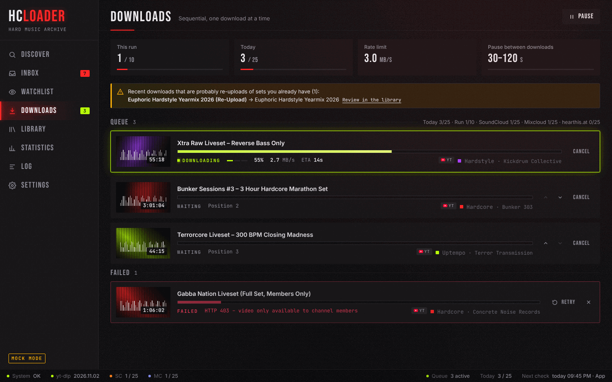
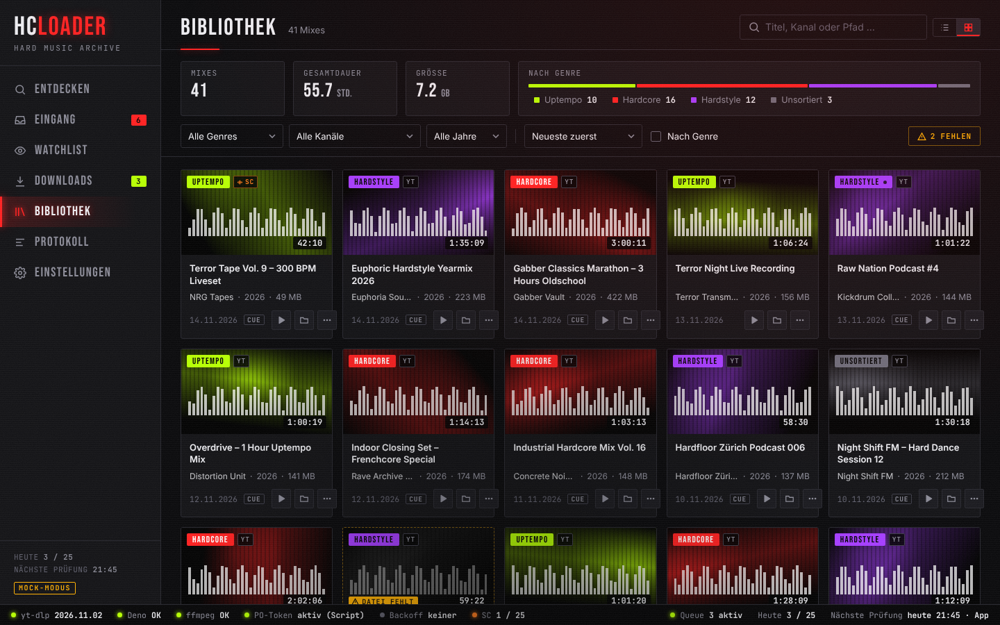

<p align="center">
  
</p>

<h1 align="center">HCLoader</h1>

<p align="center">
  Find, filter and archive <b>Hardstyle, Rawstyle, Hardcore and Uptempo DJ mixes</b> as tagged MP3s,<br>
  with as little load on YouTube as possible.
</p>


> The screenshots in this repository are taken in the app's mock mode, so the mixes and channels
> shown are sample data. The app's own interface is in **Swiss German (de-CH)**; the documentation
> is in English.

HCLoader is a Windows 10/11 desktop app (Python, pywebview/WebView2, plain HTML/CSS/JS UI). You
search or follow channels and playlists, filter by duration, keywords, genre and upload date, and
HCLoader downloads the mixes one at a time into a local library: MP3 with ID3v2.4 tags, embedded
cover and a CUE file generated from chapters. The folder structure is friendly to media servers
such as Plex or Jellyfin.

## Features

- **Discover**: free-text search with genre chips, live filters (duration, upload period or year,
  genre, include/exclude keywords, channel blacklist, hide already downloaded or ignored) and
  sorting by relevance, date, duration or views.
- **Watchlist and Inbox**: follow channels, playlists and saved searches. New videos that pass all
  filters land in the Inbox, or are downloaded automatically per source.
- **Download queue**: strictly sequential, one active download, live progress, pause, cancel,
  reorder, retry.
- **Library**: browse what you have downloaded (list or grid, grouped by genre), re-tag, open the
  folder, delete. Built-in mini player with chapter markers (in development).
- **Tagging**: ID3v2.4 (title, artist, album artist, album, genre, date, comment, source id),
  square cover art, `.cue` file and ID3 chapters from the video's chapters or timestamps.
- **Genre detection** from keywords with priorities; editable genres, colors and keywords.
- **Scheduled checks** inside the app and via the Windows Task Scheduler (headless mode).
- **Gentle by design**: central throttle, daily and per-run limits, randomized pauses,
  backoff on HTTP 429 or bot checks. See [Being nice to YouTube](#being-nice-to-youtube).
- **19 languages** (from v0.2.0): English (default), German, Chinese (Simplified), Hindi, Spanish,
  French, Bengali, Portuguese (Brazil), Russian, Indonesian, Dutch, Flemish (Belgium), Swedish,
  Norwegian (Bokmål), Finnish, Lithuanian, Latvian, Estonian and Fränggisch (fun dialect). «Automatic» follows the
  Windows display language; switching applies at once.
- **Everything configurable in the GUI**, every setting with help text, default and reset.
- **Portable or venv install**, a one-click yt-dlp/plugin update, SQLite state, DB backups.
- **Sources**: YouTube today; SoundCloud is in development. See
  [Supported sources](https://github.com/kellerict/HCLoader/wiki/Supported-Sources).

<p align="center">
  
  
</p>

## Requirements

**Installer and portable ZIP: nothing to install.** Python, Deno, ffmpeg/ffprobe and the PO-token
provider are already included.

- Windows 10 or 11, 64-bit
- Microsoft Edge **WebView2 Runtime** – preinstalled on Windows 11 and up-to-date Windows 10;
  otherwise install the Evergreen runtime from Microsoft
- Internet access
- No admin rights needed

Only if you run HCLoader **from source** (developers, `scripts/setup.ps1`): Python 3.12+ and
optionally git.

## Quick start

### Option A: installer (recommended)

1. Download `HCLoader-Setup-<version>.exe` from the
   [latest release](https://github.com/kellerict/HCLoader/releases/latest).
2. Run it. The installer is not code-signed, so Windows SmartScreen may say "Windows protected your
   PC": click **More info** ("Weitere Informationen"), then **Run anyway** ("Trotzdem ausführen").
3. Keep the default folder (`%LOCALAPPDATA%\Programs\HCLoader`, per user, no admin rights), optionally
   tick the desktop shortcut, finish. Start HCLoader from the Start menu.

Your data lives in `%APPDATA%\HCLoader\`; the app updates itself (or install a newer setup over it).
Uninstall via Windows Settings › Apps: it removes the program folder and its scheduled task, but
never your data or music. Details: [Installation](https://github.com/kellerict/HCLoader/wiki/Installation).

### Option B: portable build (no install, movable)

1. Get the ZIP `HCLoader-portable-<version>-win64.zip` (see [Updating](#updating) for where
   releases are published) or build it yourself (below).
2. Right-click the ZIP, **Properties**, tick **Unblock**, OK. Then extract it to a **short path**
   such as `C:\Tools\` (long paths can exceed Windows' 260-character limit).
3. Double-click `HCLoader\HCLoader.cmd`.

Build it yourself with Windows PowerShell 5.1 (internet required, no admin rights):

```powershell
powershell -ExecutionPolicy Bypass -File scripts\build_portable.ps1 -OutDir C:\hcl -Zip
```

Details, the other launchers and moving the folder: [Portable build](https://github.com/kellerict/HCLoader/wiki/Portable-Build).

### Option C: venv install from source

```powershell
git clone https://github.com/kellerict/HCLoader.git
cd HCLoader
.\scripts\setup.ps1
```

`setup.ps1` creates `.venv`, installs the dependencies, downloads Deno, ffmpeg, ffprobe and the
PO-token provider into `bin\` and creates a desktop shortcut. It is idempotent
(`-Force`, `-SkipBinaries`, `-NoShortcut`, `-Dev` are available). Start the app with the shortcut or:

```powershell
.\.venv\Scripts\python -m app.main
```

More: [Installation](https://github.com/kellerict/HCLoader/wiki/Installation), [Getting started](https://github.com/kellerict/HCLoader/wiki/Getting-Started).

> On recent Windows 11 builds VBScript may be disabled. Use `HCLoader.cmd`
> (not `HCLoader.vbs`) in that case.

## Usage overview

| View | What it does |
|---|---|
| **Entdecken** (Discover) | Search, filter, pick mixes, download or ignore them. |
| **Eingang** (Inbox) | New matches from your watchlist waiting for your decision. |
| **Watchlist** | Channels, playlists and saved searches that are checked incrementally. |
| **Downloads** | The queue with live progress, today's and this run's counters, pause and retry. |
| **Bibliothek** (Library) | Everything you have downloaded; re-tag, open folder, delete, play. |
| **Protokoll** (Log) | Live log and run history (manual, watchlist, scheduled). |
| **Einstellungen** (Settings) | All options in tabs: general, filters, genres, download, storage, throttle, SoundCloud, network and PO token, schedule, appearance, maintenance. |

The navigation labels are German; the English names above are used throughout the documentation.
See the wiki pages [Discover and search](https://github.com/kellerict/HCLoader/wiki/Discover-and-Search),
[Watchlist and Inbox](https://github.com/kellerict/HCLoader/wiki/Watchlist-and-Inbox),
[Downloads and queue](https://github.com/kellerict/HCLoader/wiki/Downloads-and-Queue),
[Library and player](https://github.com/kellerict/HCLoader/wiki/Library-and-Player) and the
[Settings reference](https://github.com/kellerict/HCLoader/wiki/Settings-Reference).

## Being nice to YouTube

HCLoader is built to be a polite client. Every network request goes through one central throttle;
there are no parallel downloads and no retry loops. All values below are defaults and can be
changed in **Settings, Schonung** (throttle).

| Setting | Default |
|---|---|
| Pause between metadata requests | 3 s |
| Pause between downloads (random) | 30 to 120 s |
| Download rate limit | 3 MB/s |
| Max downloads per run | 10 |
| Max downloads per day | 25 |
| Max searches per hour | 20 |
| Watchlist check interval | 24 h |
| Entries read per source | 30 |
| Backoff after HTTP 429 or "confirm you're not a bot" | 6 h, doubling up to 48 h, reset after a successful run |

Cheap before expensive: results come from flat metadata queries, are filtered, and only then are
individual videos resolved and downloaded. A video is never downloaded twice (SQLite state plus
yt-dlp download archive). While a backoff is active, search, watchlist and downloads are blocked
and the status bar shows the remaining time. SoundCloud has its own limits, counters and backoff.
More in [Throttling and backoff](https://github.com/kellerict/HCLoader/wiki/Throttling-and-Backoff).

## Folder structure and tags

Default layout (changeable with a path template):

```
<target folder>\<Genre>\<Artist>\<Year>\<YYYY-MM-DD> - <Title> [<video id>].mp3
```

Example: `D:\Music\HCLoader\Hardcore\Partyraiser\2026\2026-10-03 - Masters of Hardcore 2026 Liveset [abc123XYZ].mp3`

The default target folder is `%USERPROFILE%\Music\HCLoader`. Genre folders use the names from your
genre list (default: Uptempo, Hardcore, Hardstyle and the fallback `Unsortiert`). The video id is
always part of the file name so that files stay unique. Details on naming, tags, cover and CUE:
[File naming and tags](https://github.com/kellerict/HCLoader/wiki/File-Naming-and-Tags).

## Data locations

| Install type | Settings, database, archive, logs, backups |
|---|---|
| Installer, venv install | `%APPDATA%\HCLoader\` (`config.yaml`, `hcloader.db`, `archive.txt`, `logs\`, `backups\`) |
| Portable build | `HCLoader\data\` (as long as `portable.txt` is next to the app) |

The environment variable `HCLOADER_HOME` overrides both. Your music lives in the target folder
you configure, not in the data folder.

## Updating

- **yt-dlp and the PO-token plugin**: Settings, Wartung (maintenance), update button. YouTube
  changes often, so keep yt-dlp current.
- **The app itself**: HCLoader checks GitHub releases at start and can download a new version in
  the background and apply it on the next restart; your data folder is left untouched and the
  database is backed up before migrations. See [App updates](https://github.com/kellerict/HCLoader/wiki/App-Updates).
  For a venv install, `git pull` and re-run `.\scripts\setup.ps1` also works.

## Troubleshooting

1. **Blank window or an error about WebView2**: install the Microsoft Edge WebView2 Runtime.
2. **Portable build does not start or files are missing**: extract to a short path
   (for example `C:\Tools\`) and unblock the ZIP before extracting.
3. **`HCLoader.vbs` does nothing**: VBScript can be disabled on recent Windows 11; use
   `HCLoader.cmd`, or `HCLoader-Konsole.cmd` to see the output.
4. **HTTP 429 or "confirm you're not a bot"**: a backoff is active. Wait it out, update yt-dlp,
   and keep the default limits.
5. **Many mixes land in "Unsortiert"**: add keywords for the genre, for example `dominator`
   under Settings, Genres.

More in [Troubleshooting](https://github.com/kellerict/HCLoader/wiki/Troubleshooting) and the [FAQ](https://github.com/kellerict/HCLoader/wiki/FAQ).
Logs are in `data\logs\hcloader.log` (portable) or `%APPDATA%\HCLoader\logs\hcloader.log`.

## Development

```powershell
.\.venv\Scripts\pip install -r requirements-dev.txt
.\.venv\Scripts\pytest
.\.venv\Scripts\ruff check . ; .\.venv\Scripts\ruff format .
.\.venv\Scripts\python scripts\ui_screenshots.py     # screenshots of all views (mock mode)
```

Tests never touch the network: non-loopback connections are blocked in `tests/conftest.py`.
Tests that really need a network (PyPI only, never YouTube) carry the marker `network` and are run
separately (`pytest -m network`). CI runs `ruff` and `pytest` on `windows-latest`. The project uses
automated QA and review steps in addition to the tests. See
[Development](https://github.com/kellerict/HCLoader/wiki/Development), [Architecture](https://github.com/kellerict/HCLoader/wiki/Architecture),
[SPEC.md](SPEC.md) (requirements, in German) and [docs/decisions.md](docs/decisions.md) (design
decisions, in German).

## Roadmap

Next up: multilingual UI (v0.2.0), festivals & series (v0.3.0), full back-catalogue import (v0.4.0), festival collector (v0.5.0) and more – see the [Roadmap](https://github.com/kellerict/HCLoader/wiki/Roadmap).

## Code signing

See the [code signing policy](CODE_SIGNING.md) (team roles, what is signed, privacy policy).

## Contributing

Issues (bug reports and feature requests) are welcome. Pull requests are limited to repository
collaborators. See [CONTRIBUTING.md](CONTRIBUTING.md) and [SECURITY.md](SECURITY.md).

## Personal use only

HCLoader is meant for **personal archiving of content you have access to**. It is not a tool for
redistributing music. You are responsible for complying with the terms of service of YouTube
(and SoundCloud) and with copyright law in your country. Respect the creators: support the artists
whose mixes you enjoy. The built-in limits exist to keep the load on these services low; please do
not work around them.

## License

HCLoader is licensed under the **GNU General Public License v3.0 or later** (GPL-3.0-or-later),
see [LICENSE](LICENSE).

Bundled third-party components keep their own licenses (listed in `THIRD_PARTY_LICENSES.txt`
inside the portable ZIP).

## Wiki

[Home](https://github.com/kellerict/HCLoader/wiki/) ·
[Installation](https://github.com/kellerict/HCLoader/wiki/Installation) ·
[Portable build](https://github.com/kellerict/HCLoader/wiki/Portable-Build) ·
[Getting started](https://github.com/kellerict/HCLoader/wiki/Getting-Started) ·
[Discover and search](https://github.com/kellerict/HCLoader/wiki/Discover-and-Search) ·
[Watchlist and Inbox](https://github.com/kellerict/HCLoader/wiki/Watchlist-and-Inbox) ·
[Downloads and queue](https://github.com/kellerict/HCLoader/wiki/Downloads-and-Queue) ·
[Library and player](https://github.com/kellerict/HCLoader/wiki/Library-and-Player) ·
[Settings reference](https://github.com/kellerict/HCLoader/wiki/Settings-Reference) ·
[Throttling and backoff](https://github.com/kellerict/HCLoader/wiki/Throttling-and-Backoff) ·
[File naming and tags](https://github.com/kellerict/HCLoader/wiki/File-Naming-and-Tags) ·
[Scheduled checks](https://github.com/kellerict/HCLoader/wiki/Scheduled-Checks) ·
[App updates](https://github.com/kellerict/HCLoader/wiki/App-Updates) ·
[Troubleshooting](https://github.com/kellerict/HCLoader/wiki/Troubleshooting) ·
[FAQ](https://github.com/kellerict/HCLoader/wiki/FAQ) ·
[Architecture](https://github.com/kellerict/HCLoader/wiki/Architecture) ·
[Development](https://github.com/kellerict/HCLoader/wiki/Development) ·
[Supported sources](https://github.com/kellerict/HCLoader/wiki/Supported-Sources)

The wiki sources live in [`docs/wiki/`](docs/wiki/) (see [docs/wiki/README.md](docs/wiki/README.md) for publishing).

---

**Kurz auf Deutsch:** HCLoader ist eine Windows-App zum Finden, Filtern und lokalen Speichern von
Hardstyle-, Hardcore- und Uptempo-Mixes als getaggte MP3, mit möglichst geringer Last für YouTube.
Die Oberfläche ist auf Deutsch (Schweiz). Nur für den privaten Eigengebrauch.
