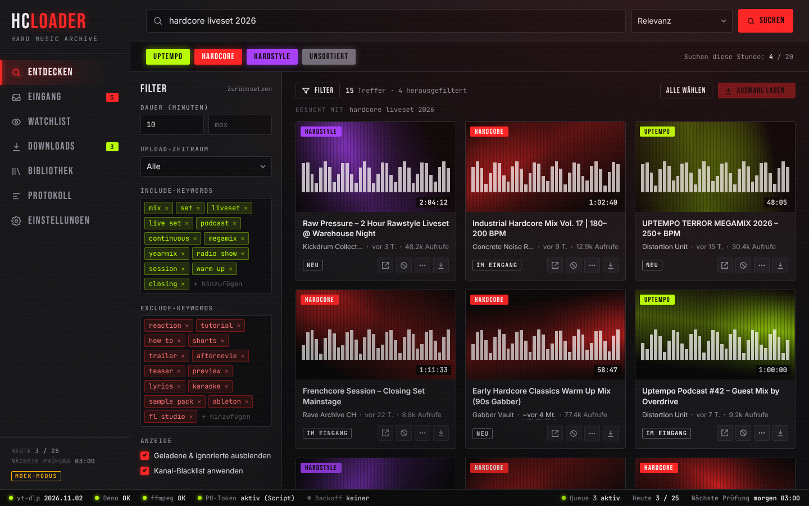

# HCLoader

Windows-Desktop-App zum Finden, Filtern und lokalen Speichern von Hardstyle-, Hardcore- und
Uptempo-Mixes von YouTube als getaggte MP3 – mit möglichst geringer Last für YouTube
(zentraler Throttle, flache Metadaten-Abfragen, Backoff bei HTTP 429, nie doppelt laden).

> **Privater Eigengebrauch.** HCLoader ist für das persönliche Archivieren von Inhalten gedacht,
> zu denen du Zugang hast. Keine Weiterverbreitung; beachte die Nutzungsbedingungen von YouTube
> und das Urheberrecht deines Landes.



## Installation (Windows 10/11, x64)

Voraussetzungen: Python 3.12+ (`py -3.12` oder `python` im PATH), Internetzugang. Git ist optional.

```powershell
.\scripts\setup.ps1
```

Das Skript legt ein lokales `.venv` an, installiert die Abhängigkeiten (`yt-dlp[default]`,
bgutil-Plugin, mutagen, ...), holt `deno.exe`, `ffmpeg.exe`, `ffprobe.exe` und den
PO-Token-Provider nach `bin/` und legt eine Desktop-Verknüpfung an. Es ist idempotent;
`-Force` holt alles neu, `-SkipBinaries` / `-NoShortcut` lassen Teile aus.
Die Binaries lassen sich auch einzeln holen: `.\scripts\fetch_binaries.ps1`.

## Start

```powershell
.\.venv\Scripts\python -m app.main                          # GUI
.\.venv\Scripts\python -m app.main --headless --run-watchlist   # für die Aufgabenplanung (Phase 4)
```

Konfiguration, Datenbank, Archiv und Logs liegen unter `%APPDATA%\HCLoader\`.

## Portable-Version (ohne Python-Installation)

Ein ZIP zum Entpacken und Starten – ohne installiertes Python, ohne git, verschiebbar (z.B. auf einen
USB-Stick). Die Installation mit `setup.ps1` (oben) bleibt der zweite Weg.

1. **Herunterladen:** GitHub → *Actions* → Workflow **Portable** → letzter grüner Lauf → Artefakt
   `HCLoader-portable-<version>-win64`. GitHub liefert Artefakte immer gezippt: Die Datei enthält
   `HCLoader-portable-<version>-win64.zip`.
2. **Vor dem Entpacken entsperren:** Rechtsklick auf das ZIP → *Eigenschaften* → **Zulassen** → OK.
   Sonst markiert Windows jede entpackte Datei als «aus dem Internet» (HCLoader entfernt die Markierung
   bei den .NET-DLLs beim Start selbst, entsperren ist trotzdem der sichere Weg).
3. **Entpacken** an einen kurzen Pfad, z.B. `C:\Tools\` oder `E:\` (der Explorer scheitert an Pfaden
   über 260 Zeichen, `node_modules` ist tief verschachtelt).
4. **Starten:** `HCLoader\HCLoader.vbs` doppelklicken. `HCLoader-Konsole.cmd` startet mit sichtbarer
   Ausgabe (Fehlersuche). `Verknuepfung-erstellen.cmd` legt «HCLoader (Portable)» auf den Desktop.

- **Daten** (Einstellungen, Datenbank, Archiv, Protokolle, Backups) liegen in `HCLoader\data\`, solange
  `portable.txt` im Ordner liegt. Ist `HCLOADER_HOME` gesetzt, gilt diese Variable zuerst.
- **Zielordner:** Default bleibt `%USERPROFILE%\Music\HCLoader`. Ein relativer Pfad wie `.\Music` wird
  in der Portable-Version relativ zum App-Ordner aufgelöst (Musik wandert mit dem Stick).
- **Update-Knopf** (Einstellungen → Wartung) aktualisiert yt-dlp und das Plugin im eingebetteten Python
  (`python\`), wie beim venv.
- **Verschieben:** Den ganzen Ordner verschieben. Danach ggf. `Verknuepfung-erstellen.cmd` erneut
  ausführen. Ist eine geplante Aufgabe eingerichtet, zeigt sie noch auf den alten Ort: Die App meldet
  «App wurde verschoben – Aufgabe neu anlegen» (Einstellungen → Zeitplan), ein Klick legt sie neu an.
- **WebView2:** Auf Windows 10/11 meist vorhanden. Bleibt das Fenster leer oder erscheint ein
  Fehler, die «Microsoft Edge WebView2 Runtime» (Evergreen) von Microsoft installieren.
- **Selbst bauen** (Windows, PowerShell 5.1, Internet; kein Python nötig):
  `powershell -ExecutionPolicy Bypass -File scripts\build_portable.ps1 -Zip` → `dist\`.
  Python-Version mit `-PythonVersion 3.12` (neueste 3.12.x mit Windows-Paket) oder exakt, z.B. `3.12.10`.
- **Lizenzen** der mitgelieferten Komponenten: `THIRD_PARTY_LICENSES.txt` und `licenses\` im ZIP.

## Smoke-Test

Lädt genau ein Video durch die komplette Pipeline (Deno, PO-Token, ffmpeg, Tags, Ablage):

```powershell
.\.venv\Scripts\python -m app.main --smoke "https://www.youtube.com/watch?v=<ID>"
```

Ausgabe: Ergebnis (`done` / `skipped` / `failed`) und Zielpfad. Ein zweiter Aufruf mit derselben URL
lädt nichts erneut (`skipped`). Exitcodes: 0 ok, 1 Fehler, 2 durch Throttle/Backoff gesperrt.

## Entwicklung

```powershell
.\.venv\Scripts\pip install -r requirements-dev.txt
.\.venv\Scripts\pytest
.\.venv\Scripts\ruff check . ; .\.venv\Scripts\ruff format .
```

Tests mocken das Netzwerk vollständig. Anforderungen: `SPEC.md`, Arbeitsregeln: `CLAUDE.md`.
