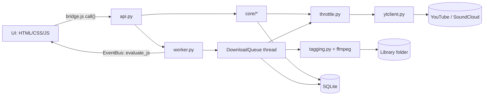

# Architecture

A concise overview for contributors. Requirements are in
[SPEC.md](https://github.com/kellerict/HCLoader/blob/main/SPEC.md) and design decisions in
[docs/decisions.md](https://github.com/kellerict/HCLoader/blob/main/docs/decisions.md) (both in
German); the UI-to-Python contract is
[docs/bridge-api.md](https://github.com/kellerict/HCLoader/blob/main/docs/bridge-api.md).

## Stack

Python 3.12+, pywebview (Edge WebView2) with a vanilla HTML/CSS/JS frontend (no build step),
yt-dlp as a **library**, Deno (JS challenges), bgutil PO-token provider, ffmpeg/ffprobe, mutagen
(ID3), pydantic v2 + ruamel.yaml (config), sqlite3 (state), pytest, ruff.

## Layout

```
app/
  main.py        entry: single instance, config, pywebview; CLI --headless / --smoke
  api.py         js_api bridge: thin delegation to core/
  worker.py      EventBus, maintenance/search workers, DownloadQueue (1 thread), PO-token watchdog
  headless.py    scheduled run (--headless --run-watchlist)
  core/
    config.py    pydantic settings <-> YAML, data folder resolution (portable aware)
    db.py        schema, versioned migrations, queries (SQLite, WAL)
    ytclient.py  the only module that imports yt_dlp (search, list, resolve, download)
    throttle.py  rate limits, sleeps, backoff state (persisted), per platform
    filters.py   pure functions: duration, keywords, status
    genre.py     genre detection
    paths.py     folder structure, file names, path length
    tagging.py   ID3, cover, CUE/chapters
    watchlist.py, library.py, player.py, scheduler.py, maintenance.py, binaries.py, ...
ui/              index.html, css/, js/ (app.js, views/*.js, bridge.js, i18n.js), fonts/, img/
scripts/         setup.ps1, fetch_binaries.ps1, build_portable.ps1, ui_screenshots.py, ...
```

Rules: `core/` does not know the GUI; `api.py` does not know yt-dlp; only `ytclient.py` imports
`yt_dlp`. Paths are `pathlib.Path`. Long operations never run in the pywebview callback thread.

## Data flow



1. The UI calls `HC.bridge.call('name', ...)`, which becomes `window.pywebview.api.name(...)`.
2. `api.py` validates and delegates to `core/` or hands long work to `worker.py`.
3. Every network access goes through the throttle, then `ytclient.py`.
4. The queue downloads, converts, tags and moves the file, and records the result in SQLite and the
   yt-dlp download archive.
5. Progress and state changes flow back as events (`EventBus`, a single dispatcher thread calling
   `window.evaluate_js`). Events sent before the window has loaded are dropped; the UI fetches its
   state on start.

## Threading

- pywebview runs each bridge call in its own thread (never the GUI thread).
- A maintenance worker (updates, backup, PO-token test), a search worker, a watchlist thread, the
  download queue (exactly one active download), the PO-token watchdog and the in-app watchlist
  scheduler are separate daemon threads.
- The throttle is thread-safe; cross-process counters and request spacing use an OS file lock so
  the GUI and a headless run cannot hit the platform at the same time. Single-instance and run locks
  use a named mutex with a file-lock fallback.

## Bridge

The UI also runs in a plain browser in **mock mode** (`ui/js/mock.js`), which is how
`scripts/ui_screenshots.py` takes screenshots of all views with Playwright. With
`?host=pywebview` the UI waits for the real API.

## Database and migrations

SQLite with one shared connection guarded by a lock, WAL mode. The schema is versioned through
a list of migration functions in `core/db.py` (`schema_version`); the app migrates at start. The
update flow takes a database backup before a new version migrates it (see [App updates](App-Updates)). Main tables: `videos`, `sources`, `source_videos`,
`channel_blacklist`, `runs`, `state` (backoff, counters), `schema_version`.

## Data and files

User data (config, DB, archive, logs, backups, sidecars, cover cache, yt-dlp cache) lives in the
data folder: `%APPDATA%\HCLoader` or `data\` in the portable build (`HCLOADER_HOME` overrides).
Logging uses a rotating file handler plus a live log stream to the UI.

## Portable mode

`portable.txt` next to the app switches the data folder to `data\`, makes relative target folders
relative to the app folder, and lets the update button use the embedded Python. The build is
`scripts/build_portable.ps1`; CI (`portable.yml`) smoke-tests it, including after moving it.
