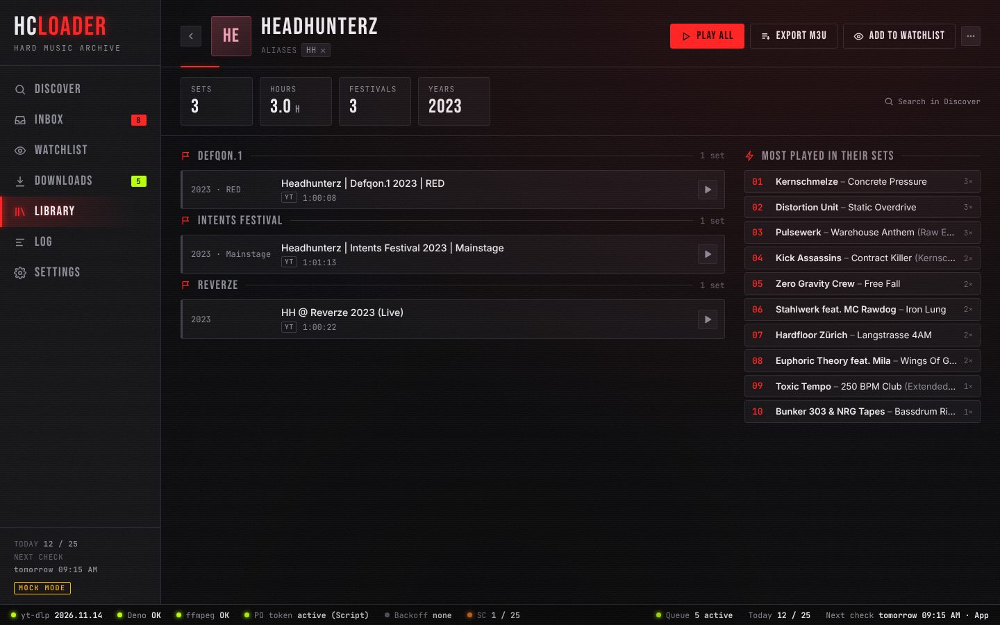

**DJs** gives every artist in your library a page – with all their sets, aliases and b2b sets –
and **playlist export** turns any part of the library into an M3U8 file for other players, a car
stereo or a phone.

## Opening the DJ list

Library → **DJs** (button next to *Tracks*). Search by name or alias, sort by number of sets,
most recent set or name. Click a card to open the DJ page; the arrow at the top left goes back.

## Who played a set?

HCLoader works it out **offline** from data it already has – no request goes to YouTube:

1. a confirmed row of a [festival checklist](Festival-Collector) (the organiser's timetable),
2. the title: `Headhunterz | Defqon.1 2024 | RED`, `Defqon.1 2024 | RED | Headhunterz`,
   `Sub Zero Project @ Qlimax 2023`, `Warm-Up Mix by Never Surrender`, `Hosted by Villain` – parts
   that name the festival, the year, a stage, a set type or only describe the mix are skipped,
3. the channel name, unless it is an organiser channel (Q-dance, Art of Dance …) or looks like a
   mix channel.

Spellings that only differ in spaces, hyphens, dots or case are the same DJ
(`Sub-Zero Project` = `SubZero Project`). A few well-known short names come built in
(`HH` → Headhunterz, `SZP` → Sub Zero Project).

**b2b sets** count for every artist: `Angerfist b2b Miss K8`, `Rebelion vs. Act of Rage`,
`Sub Zero Project x Dr. Peacock` and `Brennan Heart & Wildstylez` appear on both pages, marked
*b2b with …*. MC credits (`feat. MC …`) are ignored. A duo with `&` in its name
(`D-Block & S-te-Fan`) is one act, not a b2b – add it with **Add DJ / act** if it is not known yet.

## A DJ page

- **Header**: initials badge, name and aliases (× splits an alias off again).
- **Stats**: sets, hours, festivals, years, b2b sets.
- **Sets**: grouped by festival (newest edition first), everything else by year; each row has the
  stage, the b2b partners, the duration and a play button.
- **Most played in their sets**: top 10 tracks from the [tracklists](Tracklist-Search) of these sets.
- **Play all** queues every set in the built-in player – when one ends, the next starts.
- **Export M3U** – see below.
- **Add to watchlist**: if HCLoader knows the DJ's own channel (from your downloads, or entered in
  *Edit*), it adds that channel; otherwise a search source `<DJ> live set`. You see exactly what will
  be added and confirm it; nothing is downloaded automatically.
- **Search in Discover** puts the name into the Discover search box (you start the search).
- Menu **⋯**: *Edit name and aliases* (also the DJ's own channel URL), *Merge with another DJ*,
  *Not a DJ – hide* (hidden DJs are listed under **Hidden** in the DJ list and can be shown again).

Merging adds all names and spellings of one DJ as aliases of the other; splitting an alias undoes
it. Your changes are stored in the database and survive updates.

## Exporting playlists

| Where | What is exported |
|---|---|
| Library → **M3U** | what you see: the selected festival edition or series, a single genre, or the current search + filters + sort order |
| DJ page → **Export M3U** | all sets of the DJ, newest first |
| Festival collector → **Playlist** | the downloaded sets of the checklist, in timetable order |
| *Continue listening* → playlist icon | your unfinished sets |

The dialog shows how many sets will be written, lets you change the file name and folder
(**Browse …** opens the Windows folder picker) and choose the path style:

- **Relative** (default): entries are relative to the playlist (`..\Hardstyle\…\set.mp3`), so the
  playlist keeps working when you move or copy the whole music folder. A file on another drive or a
  network share cannot be relative on Windows – it is written with its full path and the dialog
  tells you how many.
- **Absolute**: full paths; the playlist can live anywhere but breaks when the music moves.

The default folder is **Playlists** inside the music folder (Settings → *Storage & tags* →
*Playlists*). File names are cleaned for Windows and shortened to fit the path length limit. If the
file already exists, the dialog asks before overwriting.

The format is standard M3U8: UTF-8, `#EXTM3U`, and one `#EXTINF:<seconds>,Artist - Title` line
per set. Sets whose file is missing are skipped.

### Keeping playlists up to date

Tick **Keep up to date after downloads** in the export dialog and turn on *Update saved playlists
after downloads* in Settings → *Storage & tags*. After every download (also the scheduled run)
these playlists are rewritten. All exported playlists are listed in the same settings section, where
you can switch *Keep up to date* per playlist, update them now, or remove them from the list (the
file stays).

Copying playlists and music to a folder or USB stick is not part of this version.
