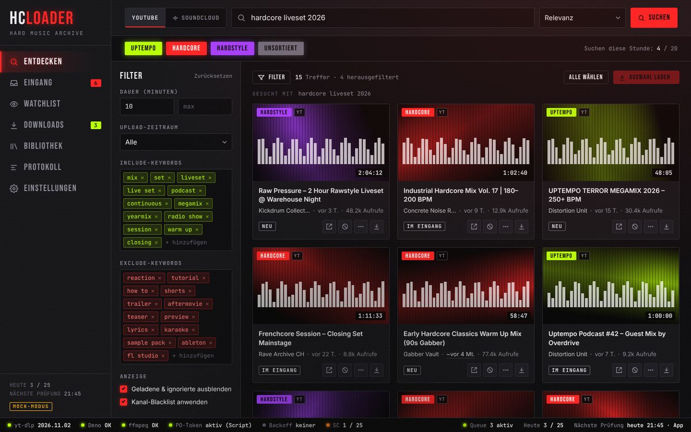

**Entdecken** (Discover) is where you find mixes on demand.

## Searching

- Type free text and press **Suchen**. HCLoader asks the platform with a flat metadata query (no
  per-video requests) and returns up to *results count* hits (default 30, max 100; Settings, Filter &
  Keywords).
- **Genre chips** (Uptempo, Hardcore, Hardstyle, Unsortiert) preselect a genre and append that
  genre's search terms to your query.
- A year filter can append the year to the query (setting *append_year*, default on).
- Searches count against the hourly search limit (default 20 per hour). The counter is shown next
  to the chips.

## Filters

The filter panel works live on the results you already have. Defaults come from your settings; you
can override them temporarily here.

| Filter | Notes |
|---|---|
| Duration (minutes) | Minimum default 10 min, maximum open. Livestreams and videos of unknown duration are always dropped. |
| Upload period | All, last 7 days, last 30 days, last 12 months, a specific year, or a custom range. |
| Genre | Multiple selection, including Unsortiert. |
| Include keywords | At least one must match the title (if the list is not empty). |
| Exclude keywords | None may match. |
| Hide downloaded and ignored | On by default. |
| Apply channel blacklist | On by default. |
| Sorting | Relevance, newest first, longest first, most views. |

Keyword matching is case-insensitive, on word boundaries, with umlauts and accents normalized. By
default only the title is checked; the description is optional (*match_description*) because flat
queries often do not return it.

About dates: a flat search only returns an approximate upload date ("3 years ago"). The year filter
therefore accepts a video if the year appears as a separate word in the title **or** the approximate
upload year matches (one year of tolerance at the edges when the date is approximate). Unknown date
and no year in the title: the video is filtered out. Filtered-out results are counted, not lost:
the header shows "N hits, M filtered out".

## Actions on a card

- **Download**: puts the mix in the queue.
- **Ignore**: never show it again (undo possible).
- **Open on YouTube** (or SoundCloud).
- **More** menu: add the channel to the watchlist, block the channel, set the genre manually.
- Select several cards, then **Alle wählen** (select all) / **Auswahl laden** (download selection).

Status badges: new, in inbox, queued, downloaded, ignored, failed.

## Blocked channels

Channels you block are hidden from all results. You can unblock them in Settings, Filter & Keywords.

## When the search is blocked

During a backoff, or when the hourly limit is reached, the search says why instead of sending a
request. See [Throttling and backoff](Throttling-and-Backoff).

---

[← App updates](App-Updates) · [🏠 Home](Home) · [Watchlist and Inbox →](Watchlist-and-Inbox)
