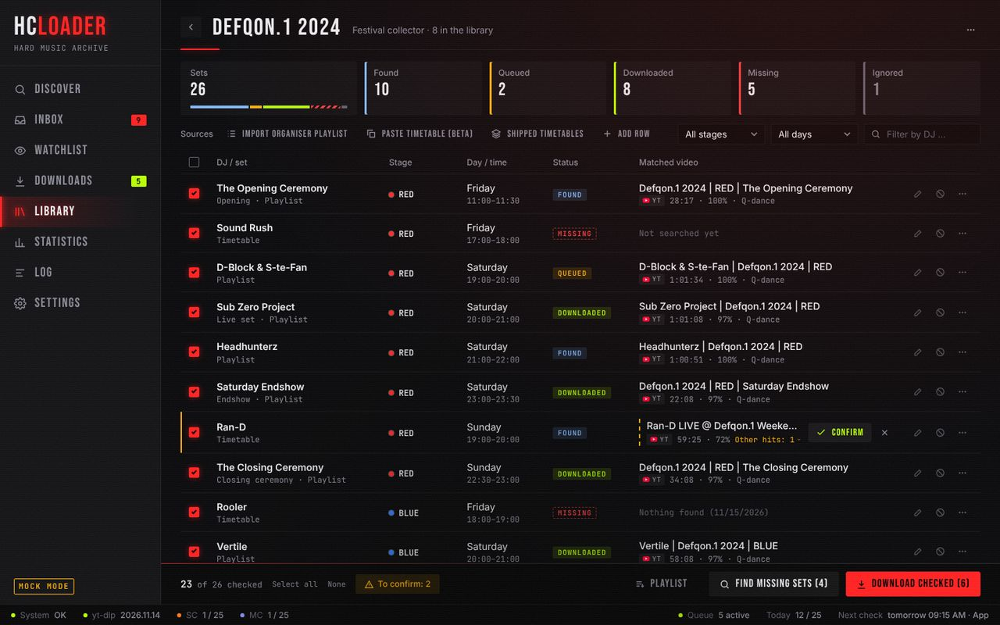
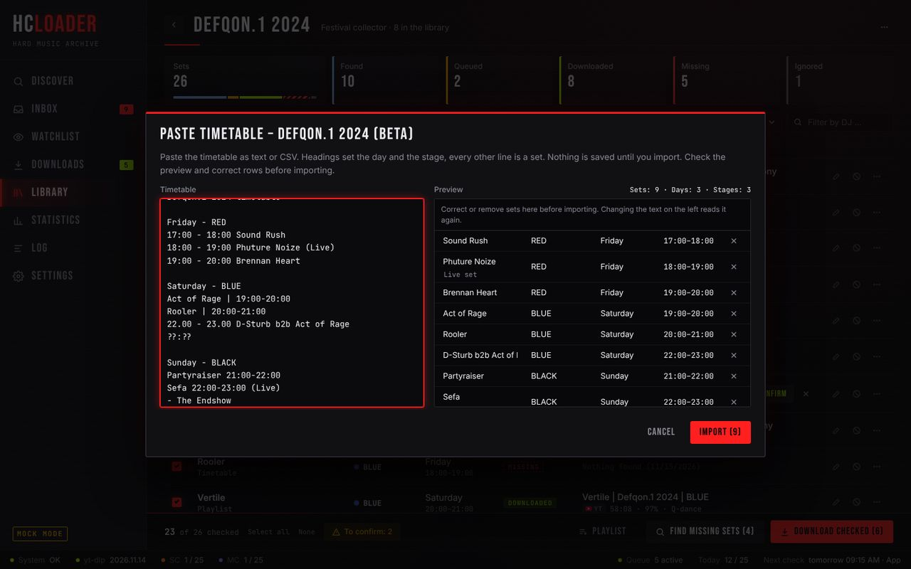

The **Festival collector** (v0.5.0) gathers all sets of one festival edition – for example
*Defqon.1 2024* – with a checklist: every expected set, what you already have, what was found and
what is still missing. You untick what you do not want, let the app look for the rest and download
the ticked sets.

It never scrapes festival websites. The rows come from the organiser's playlist, a timetable you
paste, a timetable file shipped with the app, or from you.

## Opening a checklist

- **Library → Collector** (next to the title) opens the overview: all checklists with their
  progress, and **New checklist** – pick a festival or series and a year (and a variant such as
  *Australia* where the series has one).
- In the library, **Group by → Festival**, open a series and select a year: **Collect this edition**
  opens the checklist of exactly that edition. Once it exists the button shows its progress
  (*Checklist 8 / 26*).

The collector stays open when you look at another view and come back; a click on **Library** in the
navigation or the arrow in the header returns to the library.

## Filling the checklist

| Source | What happens |
|---|---|
| **Import organiser playlist** | Paste the link of the official liveset playlist (YouTube playlist or SoundCloud set). One flat listing, read page by page through the throttle; nothing is downloaded. Every entry becomes a confirmed row, with DJ, stage and set type taken from the title. Entries that are too short, aftermovies and trailers are added unticked. |
| **Paste timetable** | Paste the timetable as text or CSV. The preview on the right shows live what was recognised; lines that were not understood are listed below it. Nothing is saved until you press **Import**. |
| **Shipped timetables** | Timetable files curated in the repository and shipped with updates. v0.5.0 ships none yet – only verified data is added. |
| **Add row** | One set by hand. |

Importing twice is safe: the same set (DJ, stage, day) is never added twice. A playlist row gets
day and times from a timetable imported later, and a timetable row gets its video from a playlist
imported later.

### Timetable format

Headings set the day and the stage, every other line is one set:

```
Saturday – RED
18:00 – 19:00 Headhunterz
19:00 – 20:00 Sub Zero Project (Live)

BLUE
Rebelion | 21:00–22:00
```

Times may be written `18:00`, `18.00`, `18h00` or `6pm`, before or after the name. Cells separated
by `|` or tabs work in any order. A plain list of names without times works too. CSV, TSV and
Markdown tables need a header row (`artist`, `stage`, `day`, `start`, `end`).

### Contributing a timetable

One JSON file per edition under `app/data/timetables/<series>/<year>.json`, with a link to the
official timetable as its source. The format is described in `app/data/timetables/README.md`; send
it as an issue or pull request.

## The checklist



- The tiles at the top count the rows per status and work as a **filter**: *Found*, *Queued*,
  *Downloaded*, *Missing*, *Ignored*. Next to the sources you can filter by **stage**, **day** and DJ.
- Each row has a **checkbox** (collect this set or not), DJ, stage, day and time, set type, its
  status and the matched video with duration and confidence.
- **Uncertain hits** are marked with a dashed line and wait for you: **Confirm**, reject with **✕**
  (the video is never suggested for this row again), or pick one of the *other hits*. The chip
  *To confirm* in the bar at the bottom shows only these rows.
- The pencil edits a row in place (Enter saves, Esc cancels). Values you edit by hand win over
  later imports. **Ignore** keeps a set in the list but out of every search and download.
- **Select all / None** in the bar at the bottom act on the rows currently shown.

## Finding missing sets

**Find missing sets** first matches the checklist against everything the app already knows (your
library, the inbox, earlier hits) – free and offline. For the rest it shows an estimate and then
searches one set at a time: `<DJ> <festival> <year>` as a flat search.

- The searches are spread evenly – 10 per hour by default – and count against the normal limit of
  searches per hour. A checklist with 30 missing sets takes about three hours; the app can stay in
  the background.
- Progress is shown above the table; **Stop** halts before the next search and **Find missing
  sets** continues later. A backoff, closing the app or an error only interrupts the search.
- A hit is confirmed automatically only when DJ, festival and year are in the title and the
  confidence is high enough. Everything else waits for your click.

## Downloading

**Download checked (n)** adds every ticked, confirmed set to the normal download queue – one after
the other, with all limits and pauses as usual. The downloads are tagged with the edition, stage
and set type of the checklist (album = edition), and the rows turn to *Downloaded* as the queue
finishes them.

## Settings

Tab *Festivals & series*, section *Festival collector* – see
[Settings reference](Settings-Reference): searches per hour, results per search and the confidence
from which a hit is confirmed automatically.
