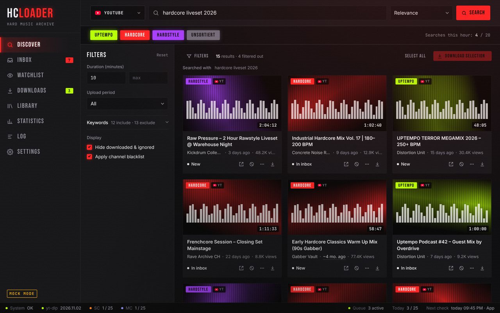
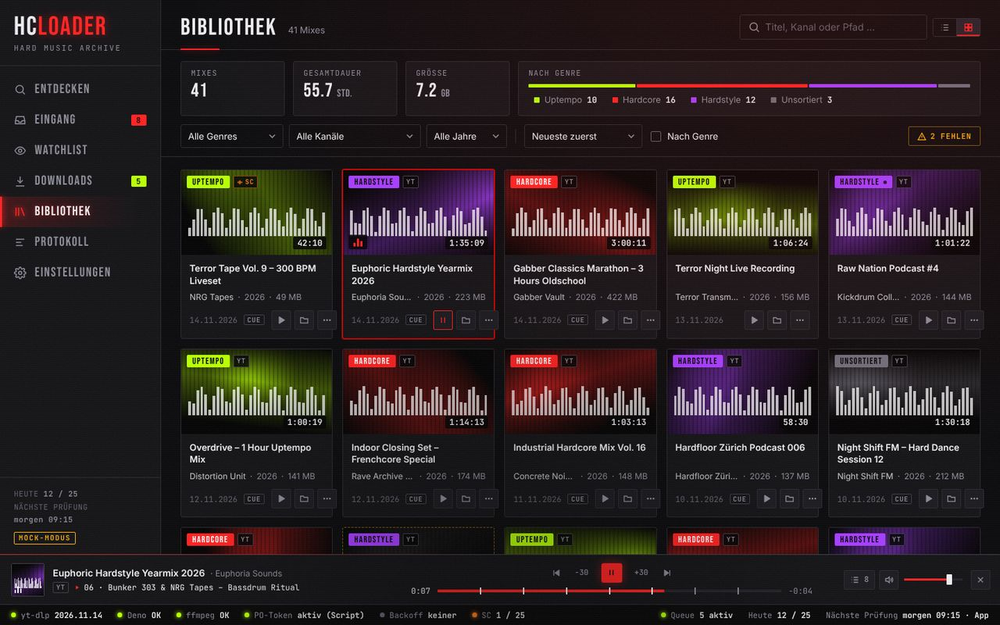
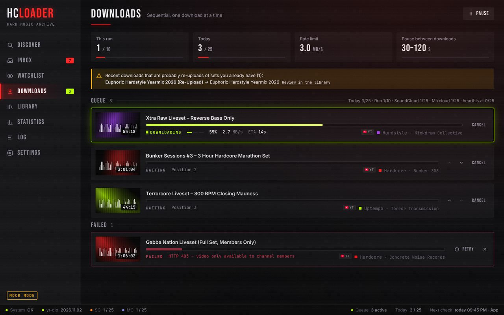
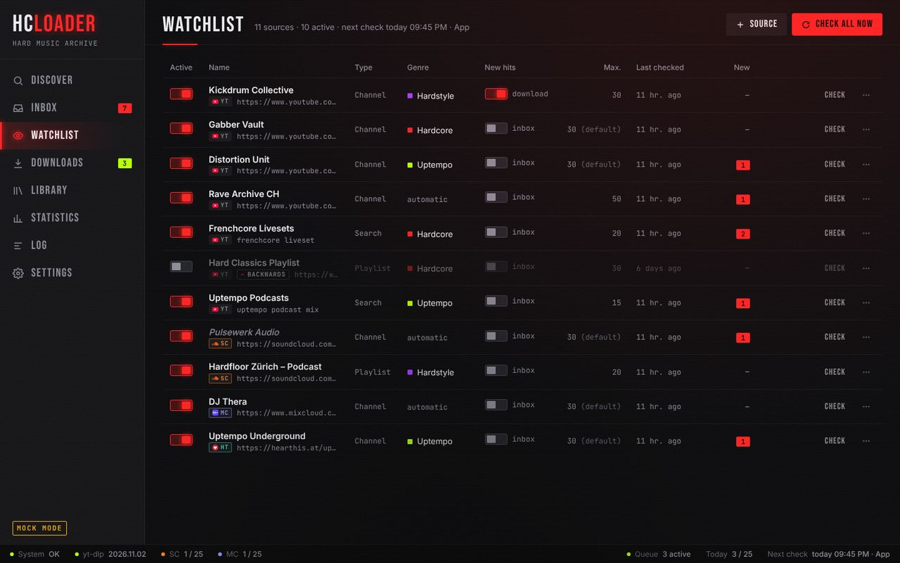

  
  
  
  

HCLoader is a Windows 10/11 desktop app that finds, filters and downloads **Hardstyle, Rawstyle,
Hardcore and Uptempo DJ mixes** as tagged MP3s for a local library, with as little load on the
source platform as possible. Sources: YouTube, SoundCloud, Mixcloud and hearthis.at.

  

  Installer or portable ZIP, no Python needed · <b><a href="https://github.com/kellerict/HCLoader/releases/latest">Releases</a></b>

## What it does

| 🔎 Discover | 👁️ Watchlist & Inbox | ⬇️ Downloads |
|:---:|:---:|:---:|
| Search on demand and filter by duration, keywords and genre before anything is downloaded. | Follow channels, playlists and saved searches. New mixes wait in the Inbox for your decision. | One download at a time, with limits per run and per day, pause and a clear queue. |
| **🎧 Library & player** | **🏷️ Tags & folders** | **🛡️ Gentle by design** |
| Browse everything you downloaded as a list or grid and play it in the app, chapters included. | Tagged MP3s with cover, chapters as CUE, and a tidy `genre/artist/year` folder layout. | One central throttle, sequential downloads and automatic backoff. Nothing is downloaded twice. |
|  |  |  |

Screenshots show mock data.

> 🌐 **Language** – The app speaks 19 languages: English (default), German (Swiss spelling), Chinese (Simplified), Hindi, Spanish, French, Bengali, Portuguese (Brazil), Russian, Indonesian, Dutch, Flemish (Belgium), Swedish, Norwegian (Bokmål), Finnish, Lithuanian, Latvian, Estonian and Fränggisch (fun dialect). Pick one in Settings ›
> General › Language. This wiki is in English; older pages may still name German labels, for
> example "Schonung" (throttle) or "Wartung" (maintenance).

> ⚠️ **Personal use only** – You are responsible for complying with the terms of service of the
> platforms and with copyright law in your country. See [FAQ](FAQ).

## Start here

1. **[Installation](Installation)** – installer recommended, or the [Portable build](Portable-Build)
2. **[Getting started](Getting-Started)** – from empty app to a tagged MP3
3. **[Troubleshooting](Troubleshooting)** – if something does not work

## Quick links

| 🎛️ Using HCLoader | ⚙️ Configuration | 🧩 Project |
|---|---|---|
| [Discover and search](Discover-and-Search) | [Settings reference](Settings-Reference) – every setting, default and range | [Roadmap](Roadmap) |
| [Watchlist and Inbox](Watchlist-and-Inbox) | [Throttling and backoff](Throttling-and-Backoff) – how HCLoader stays gentle | [Architecture](Architecture) |
| [Downloads and queue](Downloads-and-Queue) | [Scheduled checks](Scheduled-Checks) | [Development](Development) |
| [Library and player](Library-and-Player) | [App updates](App-Updates) | [FAQ](FAQ) |
| [Statistics](Statistics) | [Notifications and media servers](Notifications-and-Media-Servers) | |
| [File naming and tags](File-Naming-and-Tags) | [Supported sources](Supported-Sources) | [Repository](https://github.com/kellerict/HCLoader) |
