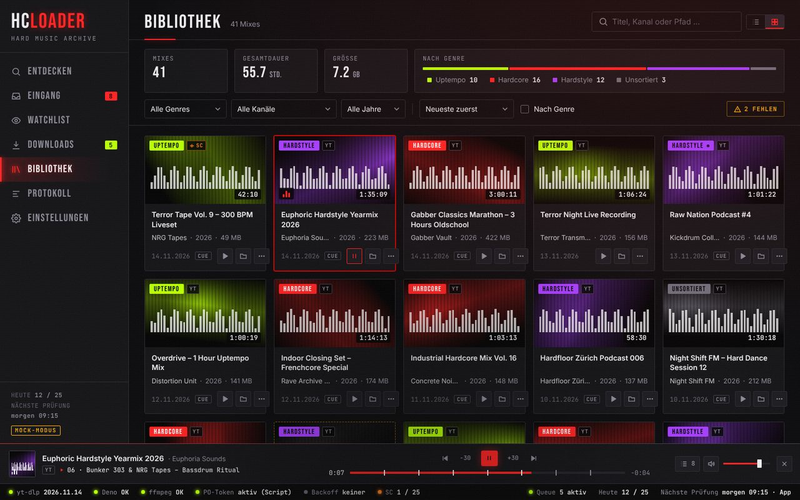
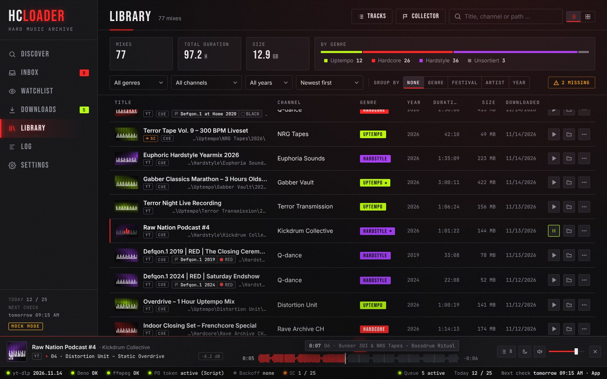
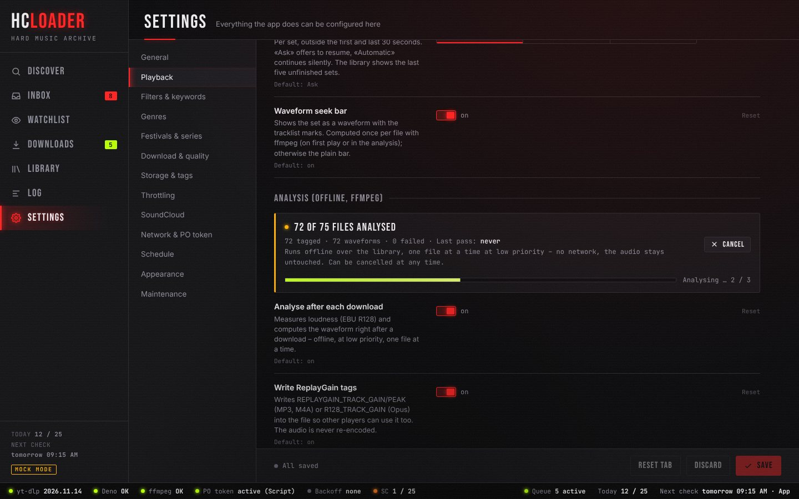

**Bibliothek** (Library) lists everything you have downloaded, from the database.

## Browsing

- Switch between **list** and **grid** view.
- **Group by**: none, genre, festival, artist (channel) or year. The choice is remembered.
- Summary tiles: number of mixes, total duration, size, mixes per genre.
- Search by title, channel, path or festival; filter by genre, channel and year; sort (default newest first).
- Entries whose file is missing on disk are flagged ("Datei fehlt"); a banner appears when the
  target folder cannot be reached.
- A **CUE** badge marks entries with a CUE file.

## Festivals and series (v0.3.0)

Many mixes are sets from a festival edition (*Defqon.1 2024 | RED | Closing Ceremony*) or episodes
of a radio show or podcast. HCLoader recognizes this offline from the stored title, channel and
description, without any extra request.

- **Group by → Festival** shows one tile per series with its kind (festival, radio show, podcast),
  the number of sets and the range of years. Entries without a festival are collected in
  **Other / unassigned**.
- Click a tile to open the series: the editions appear as a compact **year timeline** (variants such
  as *at Home* are separate editions), below it the sets of the selected edition **grouped by
  stage**. **All** lists every edition. Play, open folder and the menu work as everywhere else, and
  search and filters stay active.
- Every entry carries a **festival badge** with edition and stage (coloured dot for stages named
  after a colour). Click it to set the series (type to search), year, variant, stage and set type,
  choose **No festival**, or **Reset to automatic**. Entries without a badge show a small **+** when
  you hover the row; the menu has the same form. Values you set by hand are marked with a dot and
  are never overwritten by the detection.
- After a change the file is **retagged immediately** (festival, year, stage and set-type tags, album
  = edition) and moved if your path template uses `{festival}`, `{event_year}` or `{stage}`. If the
  file is missing only the entry is updated.
- Detections below the threshold are shown as **dashed suggestions** with a question mark; the check
  mark accepts them.

To gather **all sets of one edition** with a checklist (timetable, missing sets, download), use the
[Festival collector](Festival-Collector): button **Collector** in the header, or **Collect this
edition** next to the selected year.

The list of series, the threshold and the one-off pass over an existing library («Assign festivals
now») are in Settings, tab *Festivals & series*; see [Settings reference](Settings-Reference).

## Actions

| Action | What it does |
|---|---|
| Play | See below. |
| Open folder | Opens Explorer with the file selected. |
| Re-tag | Rewrites tags, cover and chapters without any network access, and moves the file to the location the current path template produces. Foreign ID3 frames (BPM, key, rating, ReplayGain, lyrics) are kept. |
| Change genre | Sets the genre manually; it is kept over automatic detection. |
| Change festival | Click the festival badge (or use the menu): sets series, year, stage and set type manually and retags the file. |
| Delete | Removes the entry and the file (and `.cue`), with confirmation (setting *confirm_delete*). Only files inside the target folder are deleted; for others there is "remove entry only". |

## Player

The setting *Play with* (`player.mode`, Settings › **Playback**) chooses what play does:

- **Built-in mini player** (default): a bar above the status bar that keeps playing when you switch
  views. Cover, title, play/pause, seek, volume and time. Chapters from the sidecar, ID3 or CUE appear
  as markers on the timeline and as an expandable track list. It only plays local files, no network.
- **Windows default player**: opens the file with your system's default audio app.

The other variant is always available per entry in the menu.

### Waveform seek bar (v0.7.0)

The timeline shows the whole set as a **waveform**: the played part in red, the rest in grey, the
tracklist as fine vertical lines. Hover to see the time and the track name, click or drag to jump
(near a track mark the pointer snaps to it). The waveform is computed **once per file** with ffmpeg –
right after the download, during the analysis pass, or the first time you play the set (then it
appears a few seconds after the start). Without ffmpeg, or with *Waveform seek bar* switched off, the
plain bar is used. *Reduce effects* turns off the fade-in.

### Loudness normalisation (v0.7.0)

Sets are mastered at very different levels. With *Normalise loudness* on, the player plays every set
at the same perceived loudness: target (default **−18 LUFS**, the ReplayGain 2.0 reference) minus the
measured loudness of the set. The gain is limited by the measured **true peak**, so a quiet set is
only raised as far as it can go without clipping. The small badge next to the track (e.g. `−10.1 dB`)
shows the gain in use; hover it for the details.

The measurement comes from the offline analysis (see below) or, for files tagged by another program,
from their ReplayGain tags. Changing the target only affects the built-in player; the tags in your
files always use the standard reference so that foobar2000, Plex, Jellyfin & co. read them correctly.

### Remember position and continue listening (v0.7.0)

The player remembers where you stopped in every set (not in the first or last 30 seconds – those
count as "not started" and "finished"). *Remember position*:

- **Ask** (default): when you play a set you left half-way, a small bar asks *Continue where you left
  off?* – **Resume** or **Start over**. Pressing play or space also starts over.
- **Automatic**: continues silently and shows *Resumed at …* with a **Start over** link for a few seconds.
- **Off**: remembers nothing.

The library shows the **last five unfinished sets** under *Continue listening* above the list (with
their progress); click one to continue right where you stopped, or **✕** to remove it from the row.
The row hides while you search or filter. Jumps from the tracklist never ask.

### Sleep timer (v0.7.0)

The moon button next to the volume sets a **sleep timer**: 15, 30, 45 or 60 minutes, or *End of this
set*. The button shows the minutes left. The last 10 seconds fade out, then playback pauses and the
volume is back to normal for the next time. Choose *Turn off* in the same menu to cancel it.

### Analysis (offline, ffmpeg) (v0.7.0)

Loudness (EBU R128 integrated loudness and true peak) and the waveform are computed **offline with
ffmpeg**, one file at a time at low priority – no network, and the audio is **never re-encoded**.

- *Analyse after each download* (default on) analyses every new file right after it is saved.
  Downloads of the scheduled background run are analysed the next time you open the app.
- **Analyse N new** in Settings › Playback runs over the existing library (progress, cancel at any
  time). **Analyse all again** measures every file once more, e.g. after you replaced files outside
  the app.
- *Write ReplayGain tags* (default on) stores the result in the file: `REPLAYGAIN_TRACK_GAIN` and
  `REPLAYGAIN_TRACK_PEAK` for MP3 (ID3 TXXX) and M4A (iTunes freeform atoms), `R128_TRACK_GAIN` for Opus
  (the Opus standard; Opus players ignore ReplayGain tags). Other containers keep the result in the
  database only. If a file is locked (for example while another program plays it), the tags are written
  by the next analysis without measuring again.
- *Precompute waveforms* (default on) computes waveforms during the analysis too; off = only when a set
  is played for the first time.

## Tracks and tracklists (v0.6.0)

**Tracks** (button next to *Collector*) searches the tracklists of all your sets: type an artist or
title, click a timestamp and the set plays from that point. The menu (**⋯**) of every entry has
**Tracklist** with clickable timestamps. Details: [Tracklist search](Tracklist-Search).

## Tip for media servers

Point Plex or Jellyfin at the target folder (type: Music). The default folder layout and the tags
are designed for it; see [File naming and tags](File-Naming-and-Tags).

---

[← Downloads and queue](Downloads-and-Queue) · [🏠 Home](Home) · [File naming and tags →](File-Naming-and-Tags)
