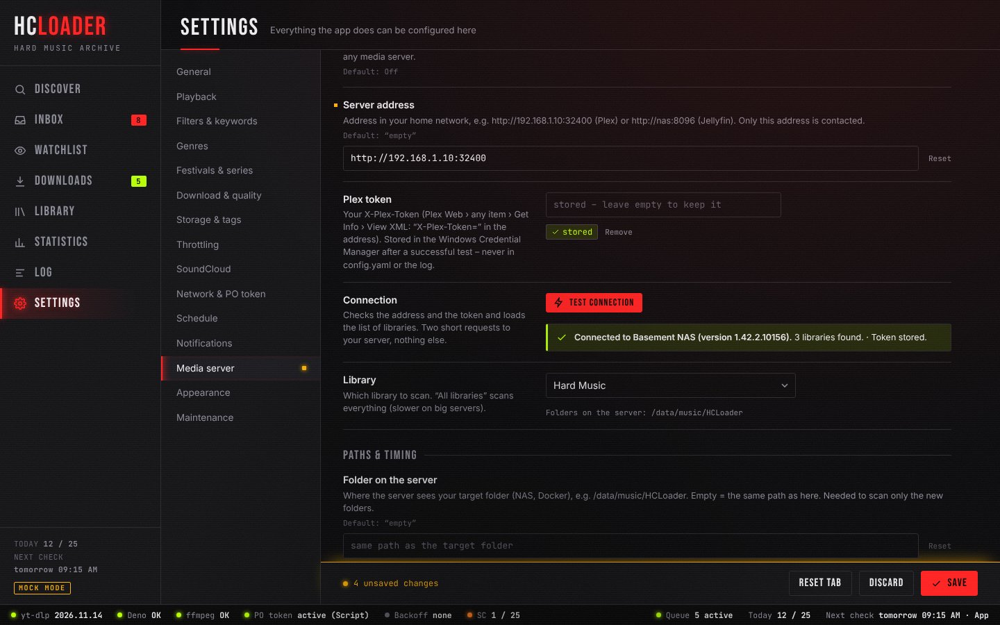

HCLoader can tell you when something happened – with **Windows notifications** – and tell your
**Plex or Jellyfin** server when new sets arrived, so they show up there without waiting for the
next scheduled library scan.

## Windows notifications

Settings › **Notifications**.

| Event | When |
|---|---|
| **New sets in the inbox** | A watchlist check (in the app or the [scheduled task](Scheduled-Checks)) put new sets into the inbox. |
| **Downloads finished** | Once per download run, with the number of sets and up to three titles. |
| **Downloads failed** | Once per run if a download failed; details stay under *Downloads*. |

**No flood:** events are collected and shown as **one** notification (for example *3 new sets in the
inbox · 2 sets downloaded*); two notifications are at least two minutes apart.

**Quiet hours** (e.g. 22:00–07:00, also across midnight): nothing is shown during that time; what
happened appears afterwards as one summary – in the app, or after the next scheduled run.

**Click** a notification to open HCLoader at the matching view (inbox, downloads or library) – if
the app is already open, its window comes to the front and switches view.

**Send test** shows a sample notification right away.

### How it works

HCLoader uses Windows' own notification system with the app ID `HCLoader.App`:

- shown through **Windows PowerShell 5.1** (part of every Windows 10/11, nothing to install). If the
  optional `winrt-Windows.UI.Notifications` package is installed in the app's Python, that is used
  instead;
- the app name/icon (`HKCU\Software\Classes\AppUserModelId\HCLoader.App`) and the `hcloader:` link
  that opens a view (`HKCU\Software\Classes\hcloader`) are registered **for your user only** (no
  admin rights); the uninstaller removes them;
- if notifications cannot be shown (PowerShell blocked by a company policy, Focus Assist), the event
  is written to the log instead. Windows' own *Do not disturb* still applies.

## Plex and Jellyfin

Settings › **Media server**.

1. Choose **Plex** or **Jellyfin** and enter the server address in your home network
   (`http://192.168.1.10:32400` for Plex, `http://nas:8096` for Jellyfin).
2. Paste the **token / API key**:
   - Plex: open any item in Plex Web › *Get Info* › *View XML*; the address contains
     `X-Plex-Token=…`.
   - Jellyfin: *Dashboard › API Keys › +*.
3. Click **Test connection**. HCLoader asks the server for its name and its libraries (two short
   requests). On success the token is stored and the list of libraries appears.
4. Choose the **library** (or *All libraries*) and **Save**.

After downloads HCLoader waits a moment (*Wait before scanning*, default 2 minutes – more downloads
in that time join the same batch) and then asks the server to scan **only the new folders**:

| Server | Request |
|---|---|
| Plex | `GET /library/sections/<library>/refresh?path=<folder>` per new folder (more than 5 folders: the whole library) |
| Jellyfin | `POST /Library/Media/Updated` with the new file paths (otherwise `POST /Items/<library>/Refresh`) |

**Folder on the server**: if the server sees your music under another path (NAS share, Docker
volume), enter the target folder as the server sees it, e.g. `/data/music/HCLoader`. HCLoader then
replaces `D:\Music\HCLoader\…` with `/data/music/HCLoader/…`. Leave it empty if the paths are the
same. Without a matching path the whole library is scanned instead.

**Scan now** asks for a full scan of the chosen library at once. The scheduled run scans after its
downloads as well.

### Privacy and safety

- The token / API key is stored in the **Windows Credential Manager** (*Windows Credentials ›
  `HCLoader/media_server/plex`* or `…/jellyfin`) – never in `config.yaml`, the database, the log or a
  backup. **Remove** deletes it.
- Only the address you entered is contacted, directly (the system proxy is not used for it),
  redirects are refused, every request times out after 10 seconds and is never retried. A failure
  is logged and shown as a message; downloads are not affected.
- This is your own server, not YouTube: it does not count against the YouTube limits.
