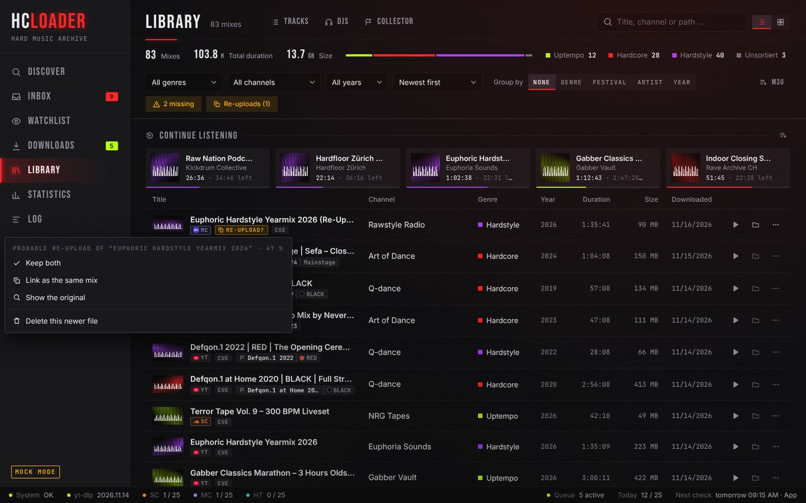

The same mix is often uploaded again: by another channel, on another platform, or by the same
channel under a new id after a takedown. HCLoader recognises such **re-uploads** by a compact
**audio fingerprint** of every set in your library. Everything runs **offline** – the fingerprint
is computed from your downloaded files with ffmpeg; no audio and no fingerprint ever leaves your
computer.

## How it works

1. After each download the new file is fingerprinted in the background (one file at a time, low
   priority, after the loudness analysis).
2. HCLoader decodes only parts of the set: the first minutes (*Minutes from the start*, default 3)
   and a few 30-second windows spread over the rest (*Extra windows*, default 3).
3. The fingerprint is a list of spectral peak pairs. They survive re-encoding, another bitrate,
   volume changes and noise; a longer or shorter intro only shifts all of them by the same amount.
4. The new set is compared with the library through a fast index. If enough of its fingerprint
   matches one set at the same time offset (*Match threshold*, default 15 %) **in at least two
   parts of the set**, the newer download is marked **"Probable re-upload of …"**.

Two different sets that open with the same track are not a match: their starts agree, but the
windows later in the set do not.

## What you see

- **Library**: a yellow **RE-UPLOAD?** tag on the newer set. Click it to decide:
  - **Keep both** – the mark disappears; nothing else changes.
  - **Link as the same mix** – both stay, the newer one shows **Same mix** (click it to undo).
  - **Show the original** – finds the older set in the library.
  - **Delete this newer file** – deletes the file; the entry is set to *ignored* and is never
    downloaded again. The original stays.
- The chip **Re-uploads (n)** above the list shows only open marks.
- **Downloads**: a note lists recent downloads that are probable re-uploads, with a link to the
  library.
- A toast appears when a new download turns out to be a re-upload.

Nothing is ever deleted automatically.

## Fingerprinting the existing library

Settings › **Re-uploads** › **Fingerprint new files** compares the sets you downloaded before
v0.10.0 (oldest first, so the newer set of a pair is the one that gets marked). It runs offline at
low priority, shows its progress and can be cancelled at any time; it continues where it stopped
the next time. **Fingerprint all again** recomputes everything (for example after changing the
windows) – your decisions stay.

Sets downloaded by the scheduled (headless) run are fingerprinted the next time you open the app.

## Check before downloading

Option **Check before downloading** (off by default): before anything is downloaded, search hits and
watchlist entries are also compared by **length (±5 s) and title** with the library on the **same**
platform – no extra request. Matches show "Probably already downloaded" and go to the inbox instead
of the queue, even for sources with automatic download. The audio fingerprint confirms or clears it
after a download.

## Limits

- Needs ffmpeg (installed by `setup.ps1` and part of the portable build).
- Sped-up, pitched or heavily edited versions (nightcore, "sped up") are not recognised.
- A re-upload with a much longer or shorter intro (several minutes) may be missed when many windows
  are used; fewer windows or more minutes from the start help.
- A fingerprint takes a few seconds per set; a large library takes a while the first time.

## Settings

| Setting | Default | Meaning |
|---|---|---|
| `reupload.enabled` | on | Re-upload detection on/off. |
| `reupload.fingerprint_after_download` | on | Fingerprint every new download. |
| `reupload.precheck` | off | Compare length and title on the same platform before downloading. |
| `reupload.head_minutes` | 3 | Minutes from the start in the fingerprint (1–10). |
| `reupload.windows` | 3 | Extra 30-second windows (0–8). |
| `reupload.min_score` | 15 | Match threshold in % (5–90). |

---

[← Supported sources](Supported-Sources) · [🏠 Home](Home) · [Settings reference →](Settings-Reference)
