What is planned for HCLoader after the first public release. The order may change – ideas and
feedback are welcome in [Issues](https://github.com/kellerict/HCLoader/issues).

| Version | Status | Planned |
|---|---|---|
| **v0.1.0** | ✅&nbsp;Released | First public release – discover, watchlist, downloads, library with player, self-update, installer and portable build |
| **v0.2.0** | 🚧&nbsp;In&nbsp;progress | **Multilingual UI** – English (default), German, Chinese (Simplified), Hindi, Spanish, Arabic (right-to-left), French, Bengali, Portuguese (Brazil), Russian, Indonesian |
| **v0.3.0** | 🗓️&nbsp;Planned | **Festivals & series** – recognise festival, year, stage and set type (Defqon.1, Qlimax, Dominator, …) as well as radio shows and podcasts; group the library by festival; album tag = edition for Plex/Jellyfin |
| **v0.4.0** | 🗓️&nbsp;Planned | **Read everything (once)** – fetch the complete back catalogue of a channel, playlist or artist into the inbox, gently and resumable |
| **v0.5.0** | 🗓️&nbsp;Planned | **Festival collector** – collect all sets of one festival edition from the organiser playlist or a timetable, with a checklist to untick sets you do not want |
| **v0.6.0** | 🗓️&nbsp;Planned | **Tracklist search** – tracklists from chapters and descriptions: «which sets play track X?» |
| **v0.7.0** | 🗓️&nbsp;Planned | **Loudness normalisation** (ReplayGain / EBU R128) · player remembers the position, waveform with chapter marks, sleep timer |
| **v0.8.0** | 🗓️&nbsp;Planned | **Playlist export** (M3U per festival, genre or DJ) · **DJ pages** with aliases |
| **v0.9.0** | 🗓️&nbsp;Planned | **Statistics** · Windows notifications for new sets · Plex/Jellyfin library scan after downloads |
| **v0.10.0** | 🗓️&nbsp;Planned | **Re-upload detection** via audio fingerprint · more sources: Mixcloud, hearthis.at, archive.org |

> 🛡️ **Same principles, every release** – gentle on YouTube (one central throttle, sequential
> downloads, automatic backoff), cheap before expensive, never download twice, everything
> configurable in the app.

Detailed concepts: [festivals & festival collector](https://github.com/kellerict/HCLoader/blob/main/docs/concepts/festivals.md).

---

[← FAQ](FAQ) · [🏠 Home](Home) · [Architecture →](Architecture)
