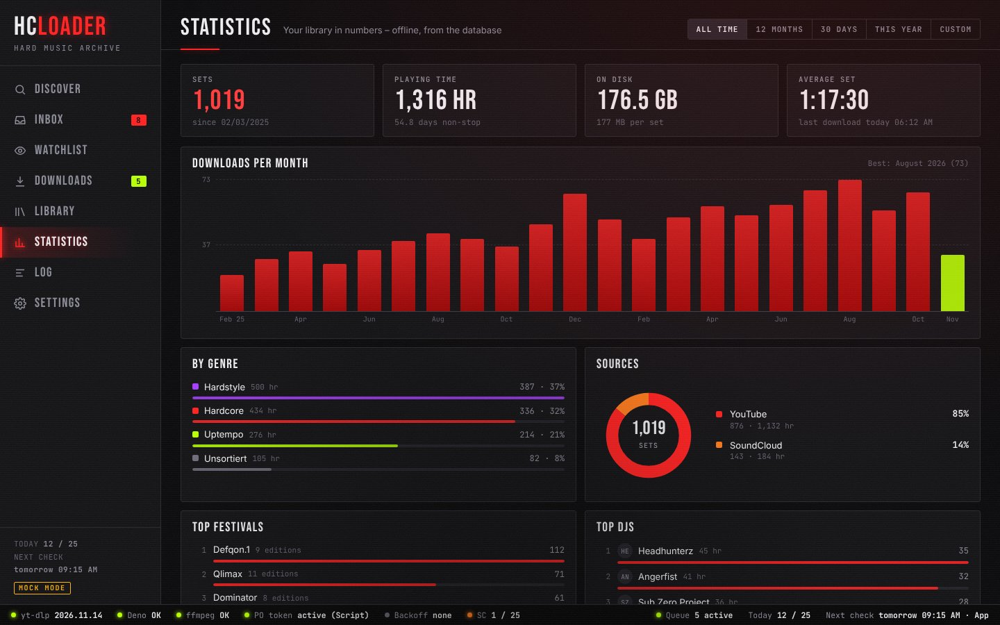

**Statistics** shows your library in numbers – how many sets, how many hours, how much disk space,
and what you actually collect. Everything is computed **offline from the database**: opening the
view sends no request anywhere.

## Opening it

Navigation → **Statistics** (or `Ctrl+6`). You can also make it the start view
(Settings › General › *Start view*).

## What you see

| Block | Content |
|---|---|
| **Totals** | Sets, playing time, size on disk, average set length; the date of the first download and of the last one. |
| **Downloads per month** | One bar per month (per year once the history is longer than three years). The current month is highlighted. |
| **By genre** | Sets and hours per genre, in the genre colours from Settings › Genres. |
| **Sources** | YouTube vs. SoundCloud as a ring chart. |
| **Top festivals** | The 10 festivals with the most sets and how many editions they cover (needs the [festival assignment](Festival-Collector)). |
| **Top DJs** | The 10 DJs with the most sets – b2b sets count for each artist. Click one to open the [DJ page](DJ-Pages-and-Playlists). |
| **By year of the set** | The event year (from the festival edition, otherwise the upload year). |
| **Most played tracks** | Tracks that appear in the most sets, from the offline [tracklists](Tracklist-Search). |
| **Watchlist activity** | Checks (in the app and scheduled), found sets, what is waiting in the inbox, and the sources that found the most. |

## Date range

Use the buttons at the top right: **All time**, **12 months**, **30 days**, **This year** or
**Custom** (from / to). The range filters by the **download date** of a set (watchlist activity by
the time of the check). Your choice is remembered.

## File sizes

From v0.9.0 the size of every downloaded file is stored with the download. For a library from an
older version the sizes are measured **once** in the background the first time you open the view
(local files only, a few seconds for thousands of files); the totals show
*“… files not measured yet”* until that is done. Files that no longer exist count as 0.

## Accessibility

Every chart has a text alternative: bars can be reached with `Tab` and show their value on focus,
screen readers get a table per chart. With **Reduce effects** (Settings › Appearance) the bars do
not animate.

## Performance

The view runs a handful of grouped queries; on a library with 10,000 sets it opens in well under a
second (the DJ list is cached and only rebuilt when the library changes).
