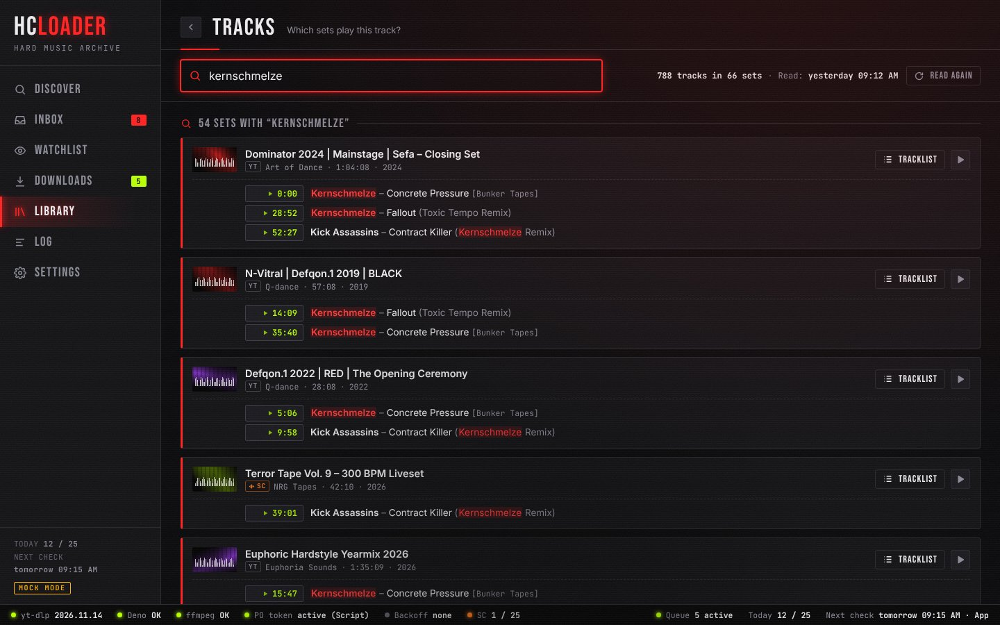

**Tracks** answers the question *"which of my sets play this track – and when?"*. It searches the
tracklists of everything in your library and jumps straight to the right moment.

## Opening it

Library → **Tracks** (button next to *Collector*). The view replaces the library list; the arrow
at the top left takes you back.

## Where tracklists come from

Everything is read **offline** from what HCLoader already stored or what is on your disk. No
request goes to YouTube or SoundCloud.

| Source | What is read |
|---|---|
| Chapters | the chapter list saved with the download (YouTube chapters, or timestamps from the description) |
| Description | the saved description: timestamped lines (`00:00 Artist - Title`, `[12:34] …`, `(1:02:03) …`, `Artist - Title 3:20`), numbered lists (`1. Artist - Title [Label]`, `01) …`, `#3 …`, `Track 01 – …`, `Track 1: …`) and plain lists below a "Tracklist:" heading |
| ID3 chapters | CHAP frames inside the MP3 (sets downloaded without metadata sidecar) |
| CUE file | the `.cue` next to the audio file |

Per set the richest source wins. Timetables (`12:00 - 13:00 Artist`), links and promo lines are
ignored; a list needs at least two tracks.

Artists and titles are tidied up: `ft.`/`featuring` become `feat.`, `X`/`VS` become `x`/`vs.`,
remix/edit/VIP information goes into brackets, a trailing `[Label]` is shown separately, and
typographic quotes and dashes are unified. Matching ignores case, accents and punctuation.

**ID tracks** – `ID - ID`, `???`, `Unknown` or `Artist - ID` – are unreleased or unidentified
tracks. They are listed dimmed; `ID - ID` is never a search hit, `Artist - ID` is found through
the artist.

## Reading the library

New downloads get their tracklist right away. The first time you open **Tracks**, HCLoader reads
the tracklists of your existing library once (progress bar, **Cancel**). Later, **Read new** only
reads sets that are new or changed since then (re-downloaded, metadata rewritten), and **Re-read
all** rebuilds everything – useful after an update of the parser. Deleted sets drop out of the
search and the most played list right away. The status line shows how many tracks in how many sets
are searchable and when the library was last read.

Sets downloaded before v0.6.0 only have the first 2000 characters of their description stored;
a tracklist at the very end of a long description may be missing for them.

## Searching

Type the start of artist or title words – the words can be in any order (`zero melt` finds *Sub
Zero Project x Devin Wild – Meltdown*; `ragon` does not find *Dragonborn*). The result lists every set that contains a matching track,
newest download first, with the matching words highlighted.

- Click a **timestamp** to play the set from that point. With the built-in player the mix starts (or
  jumps, if it is already playing). With **Settings → Player → External player** the file opens in
  your default player and a message tells you the time to jump to.
- Sets from numbered lists without timestamps show `–:–`.
- **Tracklist** opens the full list of that set; **▶** plays it from the start.

Without a search term the view shows the **Most played tracks**: the 20 tracks that appear in the
most sets (at least two). *Original Mix* and *Extended Mix* count as the same track, a remix or
VIP as a different one. Click one to search for it.

## Tracklist of a single set

In the library, open the menu (**⋯**) of an entry → **Tracklist**. The panel lists all tracks with
position, clickable timestamp, artist, title, version and label, and names the source (chapters,
description, ID3 chapters, CUE file). A set that was never read is read on the spot.

## Notes

- The search uses SQLite's full-text index (FTS5) and stays fast with thousands of sets. If your
  Python's SQLite lacks FTS5, HCLoader falls back to a simpler search and shows an info icon.
- Tracklists are stored in the database (`hcloader.db`); the migration to v0.6.0 makes a backup
  first, like every schema update.
