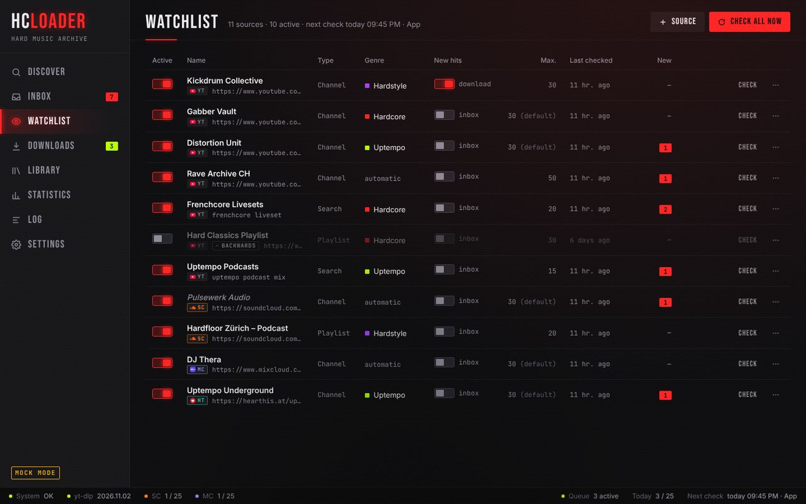
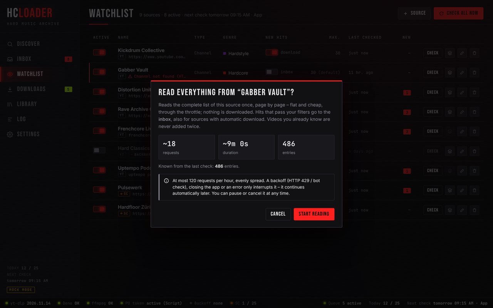
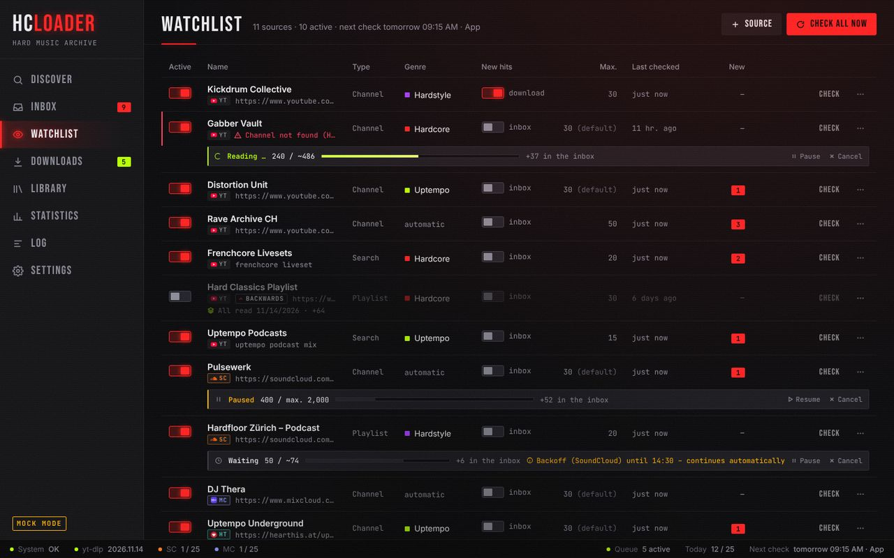

## Watchlist

The **Watchlist** holds the sources HCLoader follows.

| Source type | Example |
|---|---|
| Channel | `https://www.youtube.com/@SomeChannel` (the channel root is read from its `/videos` tab) |
| Playlist | A YouTube playlist URL |
| Search | A saved search query |

Per source you can set: name (HCLoader can suggest one and replaces it with the real channel or
playlist name after the first check), URL or query, default genre (optional), active on/off,
**auto-download** (download matches directly instead of sending them to the Inbox), and the
maximum entries per check (empty = *entries per source* from Settings, Zeitplan; max 200, 100 for
searches). The table shows when a source was last checked and how many new hits it found.

Buttons: **Prüfen** (check one source) and **Alle jetzt prüfen** (check all).

### How a check works

- Sources are read newest first, via a flat metadata query.
- A check stops at the first video **this source** has already seen. A video known only from a
  search or another source does not stop it. The very first check of a source never stops early.
- Search sources skip known videos but never stop early, because relevance order is not
  chronological.
- New videos that pass all filters go to the Inbox (or the queue with auto-download). Videos that
  fail the filters are stored as "new" and not shown again as new.
- **Playlists that append new videos at the end** can be handled with the "newest are at the end"
  option. It reads the last N entries, which costs roughly one request per 100 playlist entries, so
  enable it only for long playlists where it is needed.
- If the platform signals a rate limit, the whole check stops and a backoff starts; the check is
  repeated after the backoff.

## Read everything (once)

A normal check only looks at the newest entries of a source (at most 200). To pick up the **back
catalogue** of a channel, playlist, SoundCloud profile or set, use the stacked-layers button
**Read everything (once)** in the source's row. Saved searches do not have it (a search returns at
most 100 results anyway).

- **Confirmation first.** The dialog shows how many requests and how much time it will take,
  without any network access: based on the size HCLoader learned from the last check (playlists
  usually report it), otherwise a conservative estimate for the maximum.
- **Gentle.** The listing is read page by page with flat, cheap requests. Every single request goes
  through the throttle: at most `backfill_requests_per_hour` per hour (default 120, i.e. one every
  30 s), plus the normal request spacing. Searches and downloads keep working in between.
- **Inbox only.** Hits that pass your filters go to the **Inbox** – never straight into the queue,
  even for sources with auto-download. Videos HCLoader already knows (downloaded, ignored, in the
  inbox, seen by this source) are never added twice. Festival detection works as for a normal check.
- **Capped.** At most `backfill_max_entries` entries per source (default 2000, 100–10000), in listing
  order (channels: newest first).
- **Progress at the source**: «Reading … 240 / ~486» with a bar, the number of hits added to the
  inbox, **Pause** and **Cancel**. When it is done, the row shows «All read <date> · +N».

**Interruptions are harmless.** The position is saved after every page. A backoff (HTTP 429 / bot
check), closing the app or a network error only interrupts the backfill; it continues automatically
at the next app start (after about 90 s), after the next watchlist check and in scheduled
(headless) runs. Continuing has to request the pages already read once more (YouTube and SoundCloud
only know "next page"), which is included in the estimate; within one run every page is read only
once. A scheduled run only continues a backfill it can finish within one hour's worth of requests –
otherwise it leaves it to the app and says so in the note (see
[Scheduled checks](Scheduled-Checks#what-a-headless-run-does)); the dialog warns about this up
front. After three errors in a row the backfill pauses with the error as a note.

**Order of the listing.** The position is an index into the listing. New uploads in the meantime
only cause a few entries to be read again; videos deleted or made private before the position
shift it back, so up to that many entries after it may be skipped – acceptable for a one-time read.

**Auto-download sources.** Everything the backfill reads goes to the inbox, including uploads that
appeared since the last check: they are then known and are not queued automatically by the next
check. Run **Check** first if you want the newest uploads of an auto-download source loaded.

**Pause** keeps the position until you click **Resume** (no automatic continuation). **Cancel**
discards the position; hits already in the inbox stay. Only one source is read at a time.

## Inbox

**Eingang** (Inbox) lists new matches from the watchlist that passed all filters, waiting for your
decision. The sidebar badge shows how many there are. Select entries and download or ignore them,
exactly like on Discover cards. Downloaded items leave the Inbox.

## Automatic checks

In the app (default every 24 h while it is open) and via the Windows Task Scheduler even when the
app is closed: see [Scheduled checks](Scheduled-Checks).

---

[← Discover and search](Discover-and-Search) · [🏠 Home](Home) · [Downloads and queue →](Downloads-and-Queue)
